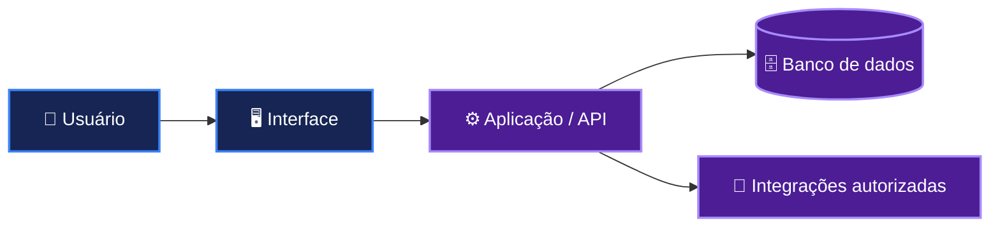

<div align="center">


### Uma solução para simplificar processos e melhorar a rotina operacional

<p>Projeto de desenvolvimento e melhoria de um sistema utilizado no ambiente de trabalho, com foco em organização, usabilidade, eficiência e evolução contínua.</p>


[Visão geral](#-visão-geral) • [Funcionalidades](#-funcionalidades) • [Arquitetura](#-arquitetura) • [Instalação](#-como-executar) • [Roadmap](#-roadmap)

</div>

---

## 💜 Visão geral

Este repositório reúne o desenvolvimento, as melhorias e a documentação de um **sistema de apoio às operações da empresa**.

O objetivo é contribuir para uma plataforma mais **intuitiva, confiável e organizada**, permitindo que a equipe acompanhe processos e realize suas atividades com maior clareza.

> [!IMPORTANT]
> **Projeto de uso profissional.** Antes de publicar código, telas ou documentação, confirme a autorização da empresa. Não inclua tokens, senhas, dados de clientes nem informações internas sensíveis.

## 🎯 Objetivos

- **Centralizar informações** relevantes em uma interface organizada.
- **Simplificar fluxos de trabalho** e reduzir etapas manuais quando possível.
- **Melhorar a experiência dos usuários** com telas claras e acessíveis.
- **Facilitar manutenção e evolução** com documentação e organização do código.

## ✨ Funcionalidades

> Esta seção é um modelo: marque somente funcionalidades realmente implementadas.

| Módulo | Descrição | Situação |
|:--|:--|:--:|
| 🧭 Painel principal | Visão organizada das informações e atividades | 📋 A validar |
| 📑 Gestão de registros | Consulta e acompanhamento de informações | 📋 A validar |
| 🔄 Integrações | Comunicação com serviços e sistemas autorizados | 📋 A validar |
| 🔔 Alertas | Sinalização de eventos que exigem atenção | 📋 A validar |
| 🔐 Acesso | Controle de acesso conforme o perfil do usuário | 📋 A validar |

<details>
<summary><b>🔎 Clique para ver a proposta de organização dos módulos</b></summary>
<br>

```text
Sistema
├── Painel inicial
├── Operações
│   ├── Consultas
│   └── Acompanhamento
├── Integrações
├── Relatórios
└── Configurações
```

*Estrutura ilustrativa, sujeita a mudanças conforme o projeto real.*

</details>

## 🧩 Arquitetura



*Diagrama conceitual. Atualize após definir a arquitetura real.*

## 🛠️ Tecnologias

Adicione apenas as tecnologias utilizadas no repositório:


> Remova os ícones que não correspondem à implementação atual.

## 🚀 Como executar

<details>
<summary><b>📦 Abrir instruções de instalação</b></summary>
<br>

As instruções dependem da tecnologia e da estrutura real do projeto. Preencha os passos abaixo antes de disponibilizar o repositório:

1. Clone o repositório autorizado.
2. Instale as dependências descritas no projeto.
3. Configure as variáveis de ambiente usando um arquivo de exemplo, **sem divulgar credenciais**.
4. Execute a aplicação de acordo com o comando definido pela equipe.

```bash
# Exemplo de clonagem — substitua pela URL real
# git clone https://github.com/USUARIO/REPOSITORIO.git
```

</details>

## 🗺️ Roadmap

- [ ] Documentar o funcionamento atual do sistema
- [ ] Identificar pontos de melhoria com a equipe
- [ ] Organizar componentes e módulos
- [ ] Melhorar navegação e experiência visual
- [ ] Implementar e validar melhorias priorizadas
- [ ] Escrever testes e revisar a documentação

## 📸 Telas do sistema

<details>
<summary><b>🖼️ Ver como incluir capturas de tela</b></summary>
<br>

Crie uma pasta `docs/imagens/` e adicione imagens **autorizadas e sem dados pessoais**.

```markdown

```

</details>

## 🤝 Colaboração

Contribuições devem seguir o fluxo definido pela equipe: criação de uma branch, revisão das mudanças e testes antes da integração ao código principal.

## 🔒 Segurança e privacidade

- Não versionar `.env`, tokens, credenciais, bancos de dados ou backups.
- Não publicar CPF, telefone, endereço ou informações identificáveis de clientes.
- Revisar logs e capturas de tela antes de fazer commits.
- Respeitar as permissões, políticas e autorizações da empresa.

---

<div align="center">

**Construído com foco em clareza, colaboração e evolução contínua.**


</div>
